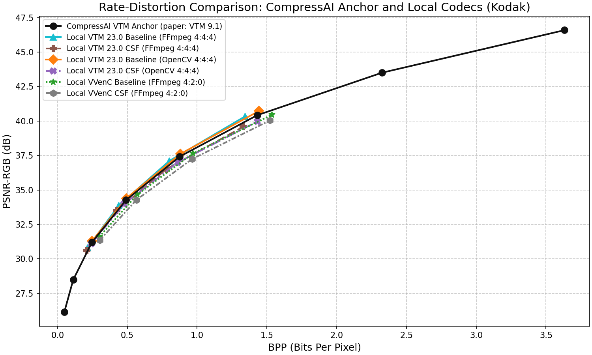
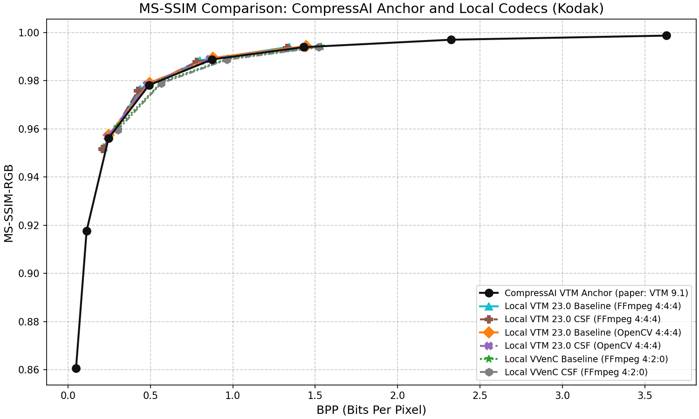
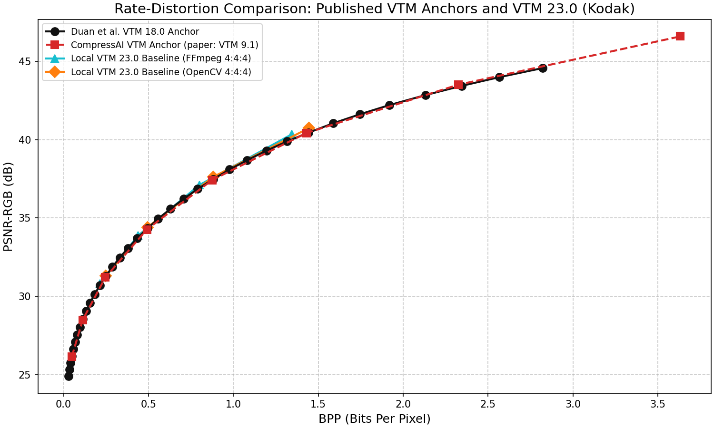

# VTM Comparison against CompressAI Anchors

This page compares the local VTM/VVenC results with the public Kodak VTM reference published by InterDigital's [CompressAI project](https://github.com/InterDigitalInc/CompressAI). The reference provides both PSNR-RGB and MS-SSIM-RGB operating points.

## Experimental Setup

The published measurements are available in [results/image/kodak/vtm.json](https://github.com/InterDigitalInc/CompressAI/blob/master/results/image/kodak/vtm.json). The codec interface is documented in [codecs.py](https://github.com/InterDigitalInc/CompressAI/blob/master/compressai/utils/bench/codecs.py), and dataset aggregation in [the benchmark CLI](https://github.com/InterDigitalInc/CompressAI/blob/master/compressai/utils/bench/__main__.py). The [CompressAI paper](https://arxiv.org/abs/2011.03029) describes VTM 9.1 with default intra configuration and 8-bit YCbCr 4:4:4 input/output. The result JSON itself does not identify its QPs, configuration file or executable hash.

The local experiment uses VTM 23.0 at QP 22, 27, 32 and 37, with OpenCV/FFmpeg 4:4:4 inputs. VVenC baseline and CSF results use FFmpeg 4:2:0 and provide additional local curves.

All local values are arithmetic means of per-image measurements on the same 24 clean Kodak images. Bpp includes the complete compressed file; PSNR-RGB is in decibels. Local RGB quality uses the original RGB8 PNG as its reference. The 10-bit reconstruction is converted back to RGB with the inverse appropriate to the input conversion, as specified in [Methods](../../methods.md#quantization-matrices).

The `CSF` legend label refers to the experimental matrix selected by the codec's `CSFScalingList` option. It does not imply that the fixed weights have been fitted to a validated contrast-sensitivity model. Solid, dashed, dash-dot and dotted lines, together with distinct markers, identify the series. Lines connect measured points for readability; no intermediate RD values are calculated.

> [!NOTE]
> The graph label “paper: VTM 9.1” identifies the version reported in the CompressAI publication; it is not version metadata embedded in the JSON. Comparisons with local VTM 23.0 remain cross-version. Unknown anchor QPs are left unspecified.

## Validation Scope

An independent [metric implementation check](../../validation.md#rgb-metric-implementation)
confirms PSNR and MS-SSIM agreement within the declared tolerances on eight
synthetic and 48 Kodak JPEG pairs. All local curves below use the shared
`pytorch_rgb_v1` protocol, including `pytorch-msssim==1.0.0` with
`data_range=255`. These checks isolate the metric calculation on identical RGB
arrays. They do not establish reproduction of the published CompressAI codec
curve: encoder versions, settings and color-conversion paths still differ.

The comparison checks the numerical reference structure, local Kodak coverage, per-image averaging and the relative positions of the published and local RD points. Actual nearest-bpp comparisons retain both signed bpp and PSNR differences; no RD interpolation or extrapolation is used.

The external curves do not prove exact numerical equivalence between metric implementations or reproduce a particular VTM executable. Local codec hash checks are performed separately by `check-codecs`. MS-SSIM and PSNR are objective reconstruction measures, not tests of perceptual invisibility.

## Scenario 1: VTM Anchor Overlap

For each local VTM23/OpenCV QP, select the actual CompressAI point with the nearest mean bpp within the published range. The QP column belongs only to the local encoder. Deltas are **local minus anchor**.

### Table 1: Local VTM 23.0 (OpenCV 4:4:4) vs. the CompressAI Reference

| Local QP | Local bpp | Anchor bpp | Delta bpp | Local PSNR-RGB | Anchor PSNR-RGB | Delta PSNR-RGB |
|---:|---:|---:|---:|---:|---:|---:|
| 22 | 1.44381 | 1.43085 | +0.01296 | 40.73303 | 40.42444 | +0.30859 |
| 27 | 0.88054 | 0.87481 | +0.00573 | 37.61649 | 37.41979 | +0.19670 |
| 32 | 0.49333 | 0.49055 | +0.00279 | 34.39830 | 34.26153 | +0.13676 |
| 37 | 0.24714 | 0.24582 | +0.00132 | 31.29380 | 31.19987 | +0.09392 |

The bpp differences are positive in these four pairs, from 0.00132 to 0.01296 bpp. The local PSNR-RGB is higher by 0.09392–0.30859 dB. Because rate, version and reconstruction details differ, these are descriptive gaps rather than equal-rate coding gains.



Black circles identify the external reference. Cyan triangles and brown filled crosses identify VTM23/FFmpeg baseline and CSF; orange diamonds and purple crosses identify VTM23/OpenCV baseline and CSF. Green stars and gray hexagons identify VVenC/FFmpeg baseline and CSF. Each series keeps the same color, marker and line style in the PSNR and MS-SSIM figures.

## Scenario 2: CompressAI MS-SSIM-RGB Reference

CompressAI publishes eight MS-SSIM-RGB values in addition to bpp and PSNR-RGB. The Duan VTM18 anchor used in the [other comparison](../lossy-vae/README.md) contains only bpp and PSNR; MS-SSIM values are not inferred for it.

### Table 2: Published CompressAI Kodak/VTM Measurements

| Point | Bpp | PSNR-RGB (dB) | MS-SSIM-RGB |
|---:|---:|---:|---:|
| 1 | 0.04824 | 26.14485 | 0.86060816 |
| 2 | 0.11250 | 28.49302 | 0.91769093 |
| 3 | 0.24582 | 31.19987 | 0.95610773 |
| 4 | 0.49055 | 34.26153 | 0.97807829 |
| 5 | 0.87481 | 37.41979 | 0.98877680 |
| 6 | 1.43085 | 40.42444 | 0.99386000 |
| 7 | 2.32461 | 43.50577 | 0.99694790 |
| 8 | 3.63261 | 46.59176 | 0.99865640 |



The local MS-SSIM calculation uses the same library call as the pinned CompressAI evaluation code, through [metrics.py](../../../src/vvcstudy/metrics.py). The metric check validates this calculation separately. Differences between the plotted coding curves still include encoder settings and color conversion; their proximity does not demonstrate bit-exact reproduction.

## Scenario 3: Local VTM 23.0 Baseline vs. CSF

The local baseline/CSF comparisons use the same encoder version and conversion within each table. Deltas are **CSF minus baseline**. Delta bpp is the difference between dataset means; it is distinct from averaging each image's percentage change.

### Table 3: VTM 23.0 Baseline vs. CSF (FFmpeg 4:4:4)

| QP | Baseline bpp | CSF bpp | Delta bpp | Baseline PSNR-RGB | CSF PSNR-RGB | Delta PSNR-RGB |
|---:|---:|---:|---:|---:|---:|---:|
| 22 | 1.34320 | 1.33023 | -0.01297 | 40.33689 | 39.58516 | -0.75173 |
| 27 | 0.80118 | 0.78003 | -0.02115 | 37.11229 | 36.51369 | -0.59859 |
| 32 | 0.43803 | 0.42347 | -0.01456 | 33.86906 | 33.49020 | -0.37887 |
| 37 | 0.21501 | 0.20959 | -0.00542 | 30.80918 | 30.62249 | -0.18669 |

### Table 4: VTM 23.0 Baseline vs. CSF (OpenCV 4:4:4)

| QP | Baseline bpp | CSF bpp | Delta bpp | Baseline PSNR-RGB | CSF PSNR-RGB | Delta PSNR-RGB |
|---:|---:|---:|---:|---:|---:|---:|
| 22 | 1.44381 | 1.43140 | -0.01240 | 40.73303 | 39.96804 | -0.76499 |
| 27 | 0.88054 | 0.85951 | -0.02103 | 37.61649 | 36.98650 | -0.62999 |
| 32 | 0.49333 | 0.47658 | -0.01675 | 34.39830 | 33.97755 | -0.42075 |
| 37 | 0.24714 | 0.24038 | -0.00676 | 31.29380 | 31.08403 | -0.20977 |

The four-QP curves also include VVenC baseline and CSF with FFmpeg 4:2:0. They characterize that configuration; differences from VTM 4:4:4 cannot be attributed to the encoder alone.

## Secondary Cross-Anchor Comparison

The following comparison uses only published measurements: each CompressAI point is paired with the actual Duan VTM18 point of nearest bpp, provided it lies inside the Duan bpp range. Deltas are **CompressAI minus Duan**; the QP is the selected Duan QP. Full results, including excluded points, are in [cross_anchor.csv](../../../results/full/analysis/anchors/cross_anchor.csv).

| CompressAI point | Duan QP | CompressAI bpp | Duan bpp | Delta bpp | Delta PSNR-RGB |
|---:|---:|---:|---:|---:|---:|
| 1 | 47 | 0.04824 | 0.04813 | +0.00012 | -0.01186 |
| 2 | 42 | 0.11250 | 0.11299 | -0.00050 | -0.04471 |
| 3 | 37 | 0.24582 | 0.24763 | -0.00181 | -0.06434 |
| 4 | 32 | 0.49055 | 0.49360 | -0.00305 | -0.06882 |
| 5 | 27 | 0.87481 | 0.88052 | -0.00571 | -0.05126 |
| 6 | 22 | 1.43085 | 1.44319 | -0.01235 | -0.02587 |
| 7 | 17 | 2.32461 | 2.34387 | -0.01927 | +0.07375 |

CompressAI point 8, at 3.63261 bpp, is outside the Duan range (maximum 2.82161 bpp) and is excluded from this numerical pairing. It remains visible in the overview plot. No extrapolation to an endpoint is performed.



## Conclusion

CompressAI supplies an external Kodak reference for both PSNR-RGB and MS-SSIM-RGB. The local VTM23/OpenCV points have slightly larger mean bpp and higher mean PSNR-RGB than their selected reference points. This supports a descriptive RD comparison, not bit-exact replication or a quantitative gain at equal rate.

For VTM23, the modified matrix reduces mean bpp together with mean PSNR-RGB at all four QPs in both conversion paths. These results should be assessed within their own encoder and conversion conditions. The external-anchor check and the local matrix experiment answer different questions.

## Reproducing the Figures

Run from the repository root:

```powershell
uv run --locked vvc-study verify
uv run --locked vvc-study plot --study anchors
```

This uses the compact measurement tables and regenerates the CSV comparisons and PNG figures without encoding images. To regenerate the matrix summaries as well, run `uv run --locked vvc-study plot --study matrices`. See [reproduction](../../reproduce.md) for running the encoding stages from original inputs.

The numerical sources are [encodings.csv](../../../results/full/tables/encodings.csv), [mean_rd.csv](../../../results/full/analysis/matrices/mean_rd.csv), [nearest_bpp.csv](../../../results/full/analysis/anchors/nearest_bpp.csv), and the attributed [anchor manifest](../../../manifests/anchors.json). The README tables are maintained documentation; analysis commands update CSV and PNG outputs, not this text.
