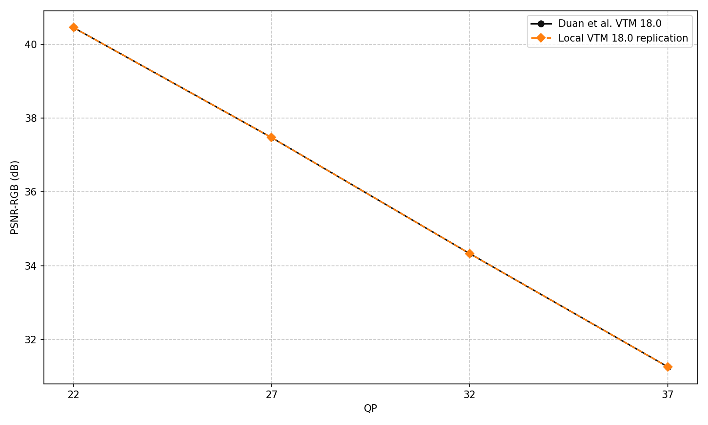
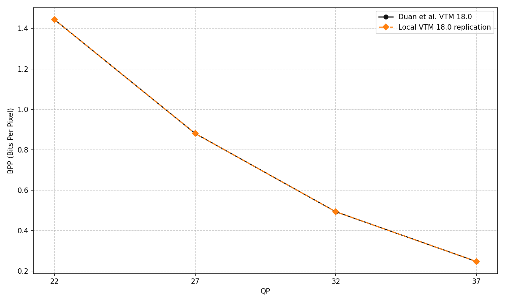
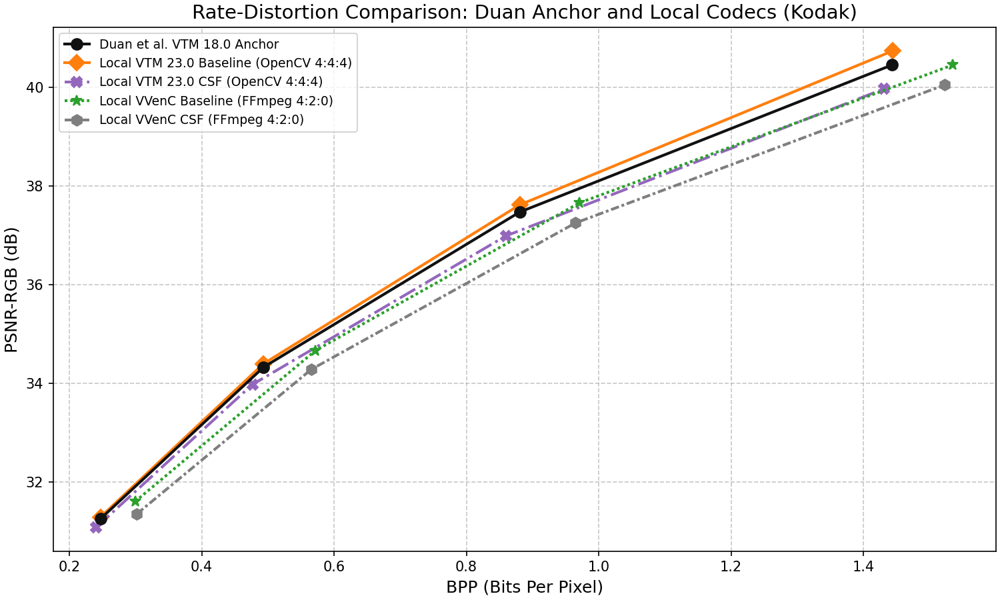
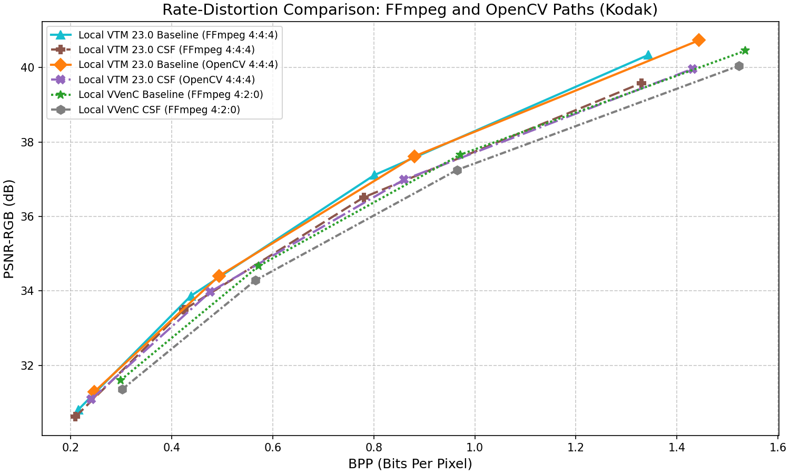

# VTM Comparison against Duan et al. Anchors

This page reports same-version VTM18 reproduction and compares separate VTM23/VVenC experiments with the Kodak VTM 18.0 anchor published in the [lossy-vae repository](https://github.com/duanzhiihao/lossy-vae). It also examines the effect of the color-conversion path and the experimental quantization matrix on the local results.

## Experimental Setup

The external reference is [kodak-vtm18.0.json](https://github.com/duanzhiihao/lossy-vae/blob/main/results/kodak/kodak-vtm18.0.json), which contains mean bpp and PSNR-RGB values. The authors' [evaluation script](https://github.com/duanzhiihao/lossy-vae/blob/main/scripts/codecs/vvc-intra-mp.py) defines QP 15–50; its [codec wrapper](https://github.com/duanzhiihao/lossy-vae/blob/main/scripts/codecs/vvc.py) uses OpenCV RGB-to-YUV 4:4:4 conversion and 8-bit RGB output after decoding.

The cross-version and matrix experiments use VTM 23.0 in All-Intra mode and QP 22, 27, 32 and 37. Two VTM input paths are compared: OpenCV 4:4:4 and FFmpeg 4:4:4. VVenC uses FFmpeg 4:2:0 and is shown as a separate configuration.

All local values are arithmetic means of per-image measurements on the same 24 clean Kodak images. Bpp includes the complete compressed file; PSNR-RGB is in decibels. Local RGB quality uses the original RGB8 PNG as its reference. For VTM23/VVenC, the 10-bit reconstruction is converted back to RGB with the inverse appropriate to the input conversion, as specified in [Methods](../../methods.md#quantization-matrices).

The `CSF` legend label refers to the experimental matrix selected by the codec's `CSFScalingList` option. It does not imply that the fixed weights have been fitted to a validated contrast-sensitivity model. Solid, dashed, dash-dot and dotted lines, together with distinct markers, identify the series. Lines connect measured points for readability; no intermediate RD values are calculated.

> [!NOTE]
> The cross-version scenarios use a VTM 18.0 reference and local VTM 23.0 results; the same-version reproduction is reported separately. RGB reconstruction and output quantization also differ. This is a cross-version comparison of measured operating points, not an exact reproduction of the authors' executable or bitstreams. Equal average bpp would not prove bitstream identity.

## Validation Scope

For same-version reproduction, use `run --study lossy-vae`, which builds VTM
18.0 and follows the authors' 8-bit decoding and OpenCV reconstruction protocol.
It compares PSNR and bpp at the same QPs after all 96 Kodak points are available.
See [validation commands](../../validation.md#vtm-180-reproduction). The VTM23
tables below remain a separate cross-version comparison; they do not stand in
for that reproduction.

### Same-version Kodak result

The completed VTM18 reproduction covers all 24 Kodak images at each of the
four QPs. Its arithmetic mean bpp and PSNR-RGB match the published values to
floating-point precision: the maximum absolute gaps are 2.23×10⁻¹⁶ bpp and
7.11×10⁻¹⁵ dB. This reproduces the published dataset means; the publication's
individual bitstreams are not available here for a bitwise comparison.

| QP | Local mean bpp | Published mean bpp | Local mean PSNR-RGB | Published mean PSNR-RGB |
|---:|---:|---:|---:|---:|
| 22 | 1.443195 | 1.443195 | 40.450315 | 40.450315 |
| 27 | 0.880521 | 0.880521 | 37.471049 | 37.471049 |
| 32 | 0.493596 | 0.493596 | 34.330353 | 34.330353 |
| 37 | 0.247631 | 0.247631 | 31.264215 | 31.264215 |





The curves overlap because both measured means agree at the same QPs.
The complete differences are retained in
[same_qp.csv](../../../results/validation/lossy-vae/full/same_qp.csv).
The following scenarios use VTM23 and remain separate comparisons.

The comparison checks the published point structure, full Kodak coverage, dataset-level averaging and the location of the local RD points relative to the external reference. Each tabulated comparison retains both the bpp gap and the PSNR gap.

The separate `check-codecs` command verifies local synthetic bitstream and reconstruction hashes. The external anchor does not replace those checks, establish perceptual equivalence or isolate the effect of a particular coding tool. The Duan VTM18 JSON does not provide MS-SSIM; that metric is discussed in the [CompressAI comparison](../compressai/README.md).

## Scenario 1: VTM 23.0 OpenCV Results and the VTM 18.0 Anchor

For each local QP, the comparison selects the actual published point with the nearest mean bpp, restricted to the published bpp range. Here the selected anchor points have the same QPs: 22, 27, 32 and 37. Deltas are **local minus anchor**. A PSNR gap at unequal bpp is not an equal-rate gain.

### Table 1: VTM 23.0 (OpenCV 4:4:4) vs. the Duan VTM 18.0 Anchor

| Local QP | Local bpp | Anchor bpp | Delta bpp | Local PSNR-RGB | Anchor PSNR-RGB | Delta PSNR-RGB |
|---:|---:|---:|---:|---:|---:|---:|
| 22 | 1.44381 | 1.44319 | +0.00061 | 40.73303 | 40.45031 | +0.28272 |
| 27 | 0.88054 | 0.88052 | +0.00002 | 37.61649 | 37.47105 | +0.14544 |
| 32 | 0.49333 | 0.49360 | -0.00026 | 34.39830 | 34.33035 | +0.06794 |
| 37 | 0.24714 | 0.24763 | -0.00049 | 31.29380 | 31.26422 | +0.02958 |

The mean bpp gaps range from about −0.00049 to +0.00061. The local mean PSNR-RGB is higher by 0.02958–0.28272 dB at these paired points. These differences describe the two complete evaluation paths; they cannot be attributed to floating-point precision alone.



The black curve shows the four published QPs used in Table 1. The orange diamonds and purple crosses show VTM 23.0 baseline and CSF with OpenCV 4:4:4. Green stars and gray hexagons show VVenC baseline and CSF with FFmpeg 4:2:0. The latter use a different chroma format and are not an isolated VTM-versus-VVenC comparison.

## Scenario 2: FFmpeg and OpenCV Conversion Paths

OpenCV `COLOR_RGB2YUV` supplies the VTM 4:4:4 input, while FFmpeg supplies limited-range YCbCr. Both reconstructions are evaluated against the same original RGB image. This comparison includes the forward conversion, coding and inverse conversion; it does not measure range alone.

### Table 2: Baseline Mean Bpp by Conversion Path

| QP | VTM 23.0 / FFmpeg 4:4:4 | VTM 23.0 / OpenCV 4:4:4 | VVenC / FFmpeg 4:2:0 |
|---:|---:|---:|---:|
| 22 | 1.34320 | 1.44381 | 1.53519 |
| 27 | 0.80118 | 0.88054 | 0.97111 |
| 32 | 0.43803 | 0.49333 | 0.57209 |
| 37 | 0.21501 | 0.24714 | 0.29932 |

### Table 3: Baseline Mean PSNR-RGB by Conversion Path

| QP | VTM 23.0 / FFmpeg 4:4:4 | VTM 23.0 / OpenCV 4:4:4 | VVenC / FFmpeg 4:2:0 |
|---:|---:|---:|---:|
| 22 | 40.33689 | 40.73303 | 40.45104 |
| 27 | 37.11229 | 37.61649 | 37.65890 |
| 32 | 33.86906 | 34.39830 | 34.66785 |
| 37 | 30.80918 | 31.29380 | 31.60719 |

At QP22, the VTM FFmpeg path uses 1.34320 bpp versus 1.44381 bpp with OpenCV, but its mean PSNR-RGB is also lower: 40.33689 versus 40.73303 dB. Lower bpp at the same QP therefore does not, by itself, establish better compression efficiency.



## Scenario 3: Local VTM 23.0 Baseline vs. CSF

Baseline and modified-matrix results are compared within each conversion path. Deltas are **CSF minus baseline**. Delta bpp is the difference between mean bpp values, not the mean percentage change per image reported in [same_qp_summary.csv](../../../results/full/analysis/matrices/same_qp_summary.csv).

### Table 4: VTM 23.0 Baseline vs. CSF (FFmpeg 4:4:4)

| QP | Baseline bpp | CSF bpp | Delta bpp | Baseline PSNR-RGB | CSF PSNR-RGB | Delta PSNR-RGB |
|---:|---:|---:|---:|---:|---:|---:|
| 22 | 1.34320 | 1.33023 | -0.01297 | 40.33689 | 39.58516 | -0.75173 |
| 27 | 0.80118 | 0.78003 | -0.02115 | 37.11229 | 36.51369 | -0.59859 |
| 32 | 0.43803 | 0.42347 | -0.01456 | 33.86906 | 33.49020 | -0.37887 |
| 37 | 0.21501 | 0.20959 | -0.00542 | 30.80918 | 30.62249 | -0.18669 |

### Table 5: VTM 23.0 Baseline vs. CSF (OpenCV 4:4:4)

| QP | Baseline bpp | CSF bpp | Delta bpp | Baseline PSNR-RGB | CSF PSNR-RGB | Delta PSNR-RGB |
|---:|---:|---:|---:|---:|---:|---:|
| 22 | 1.44381 | 1.43140 | -0.01240 | 40.73303 | 39.96804 | -0.76499 |
| 27 | 0.88054 | 0.85951 | -0.02103 | 37.61649 | 36.98650 | -0.62999 |
| 32 | 0.49333 | 0.47658 | -0.01675 | 34.39830 | 33.97755 | -0.42075 |
| 37 | 0.24714 | 0.24038 | -0.00676 | 31.29380 | 31.08403 | -0.20977 |

## Conclusion

The same-version VTM18 experiment reproduces the published Kodak mean bpp and PSNR-RGB at all four tested QPs to numerical rounding. The following conclusions about VTM23 remain separate from that reproduction.

The external anchor provides a numerical reference for the local VTM 23.0 curves, with both rate and quality differences retained. It does not establish same-version reproduction. Within both VTM conversion paths, the modified matrix lowers mean bpp and mean PSNR-RGB at all four QPs. These same-QP changes do not establish an improvement at equal quality.

The conversion comparison uses one original-RGB quality reference throughout. Its results describe complete conversion and coding paths; they should not be described as a universal penalty of OpenCV or a benefit of FFmpeg.

## Reproducing the Figures

Run from the repository root:

```powershell
uv run --locked vvc-study verify
uv run --locked vvc-study plot --study anchors
uv run --locked vvc-study plot --study lossy-vae
```

This uses the compact measurement tables and regenerates the CSV comparisons and PNG figures without encoding images. To regenerate the matrix summaries as well, run `uv run --locked vvc-study plot --study matrices`. See [reproduction](../../reproduce.md) for running the encoding stages from original inputs.

The numerical sources are [encodings.csv](../../../results/full/tables/encodings.csv), [mean_rd.csv](../../../results/full/analysis/matrices/mean_rd.csv), [nearest_bpp.csv](../../../results/full/analysis/anchors/nearest_bpp.csv), and the attributed [anchor manifest](../../../manifests/anchors.json). The README tables are maintained documentation; analysis commands update CSV and PNG outputs, not this text.
